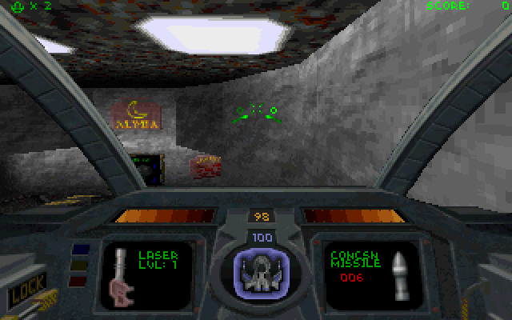
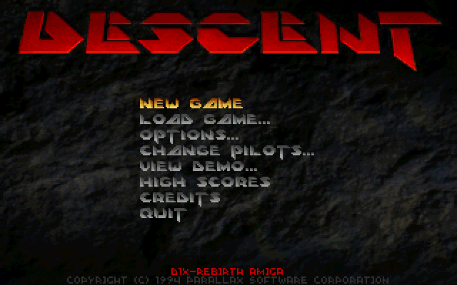
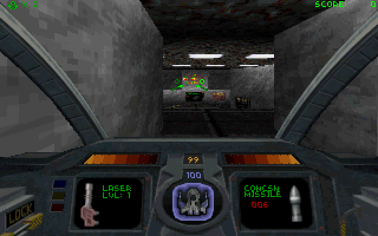

# Descent

**DXX-Rebirth, the six-degrees-of-freedom shooter, on the Amiga.**

  

  
  

Captured from this build running on AmigaOS.

Fly a Pyro-GX through the mines of the solar system, blast the infected robots and get out before the reactor blows. DXX-Rebirth keeps Parallax's Descent alive, and this is its native Amiga build of Descent 1: the software renderer, the sound effects, the movies and the full game on the 68040.

## What you need

A 68040 with an FPU, AmigaOS 3.2 or later, AHI, and a 512 KB stack (the icon asks for it). AGA or an RTG card.

No game data comes with this port. Put `descent.hog` and `descent.pig` from Descent 1 (the free shareware 1.4, or the full game 1.4/1.5) in the `Data` drawer.

## Controls

| Key | Does |
|---|---|
| Arrows | Pitch and turn |
| A / Z | Forward / back |
| Ctrl | Fire primary |
| Space | Fire secondary |
| Esc | Menu |
| F1 | Help, with every key |

## What works

- Descent 1 in 320x200 (other sizes in Options > Graphics)
- Sound effects and the movies through AHI
- Pilots, saved games and demos in the Descent drawer

## Not in this build yet

- Music (HMP/MIDI) and CD audio
- Network games
- OpenGL, the level editor, PNG screenshots (they are PCX)

## Building

The Amiga build, its make file and what was changed for the 68k are described in [AMIGA_PORT.md](AMIGA_PORT.md).

## Credits and licence

DXX-Rebirth by the DXX-Rebirth Team, from Parallax Software's Descent ([upstream](https://github.com/dxx-rebirth/dxx-rebirth)). Licence: GPL 3 with the Parallax licence: share it freely, never sell it.

Amiga port by The AmiCradle Team.

The original project's README is [README.upstream.md](README.upstream.md).
